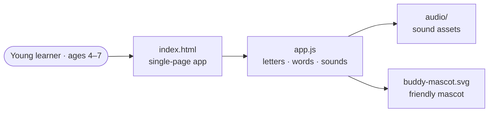

# English Learning App

A simple **English learning app for young students (ages 4–7)** — letters, words and sounds with a friendly mascot buddy.

**Live:** https://english-learning-app-thiteswapnil1212-hues-projects.vercel.app/

## What's inside

- `index.html` — the app
- `app.js` — game/learning logic
- `styles.css` — styling
- `audio/` — sound assets
- `buddy-mascot.svg` — the mascot

## Tech stack

Vanilla HTML · CSS · JavaScript (no framework, no build step)

## Architecture



## Run it

Open `index.html` in a browser, or serve the folder:

```bash
npx serve .
```
