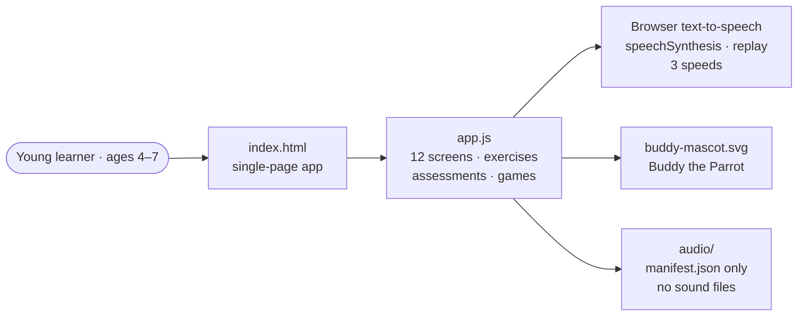

# English Learning App

A simple **English learning app for young learners (ages 4–7)** — first greetings and sentences, taught through a guided lesson with games, spoken narration and a friendly parrot mascot.

**Live:** https://english-learning-app-thiteswapnil1212-hues-projects.vercel.app/

## What it is

One guided lesson — **"Say Hello!"** — built for a young child (or a teacher with a small class) learning their first English greetings:

- Say "Hello!"
- Say "My name is..."
- Ask "What is your name?"
- Respond confidently

The lesson runs as **12 screens** (`totalScreens: 12` in `app.js`), moving from introduction through practice to a short check of what was learned.

## What's inside the lesson

- **3 exercises** and **3 assessments** — short checks woven through the lesson (`exercise1–3`, `assessment1–3`)
- **Flashcards** — flip-through cards for the lesson words
- **Matching game** — match words to what they mean (`gameMatches`)
- **Animal guessing game** — guess the animal from clues, in six phases: intro → clues → guess → teach → repeat → celebrate
- **Stars** — the app awards stars as the child progresses
- **Progress bar** — "Lesson progress" from 0% to 100% at the top of every screen
- **Objectives panel** — the 4 lesson objectives, ticked off as each one is completed
- **Teacher notes panel** — guidance for the current screen, for the adult running the lesson

## How it works

- **Spoken narration** — every screen is read aloud with the browser's built-in text-to-speech (`speechSynthesis`, shown as a "TTS" indicator). There are no recorded sound files in the repo: `audio/` contains only a `manifest.json`.
- **Replay narration** — a "परत ऐका" (listen again) button replays the current screen's narration.
- **Narration speed** — three speeds, labelled in Marathi: साधारण (normal), हळू (slow), खूप हळू (very slow).
- **Marathi support** — the narration controls and speed labels are in Marathi (Noto Sans Marathi font), so a Marathi-speaking parent or teacher can run the lesson.
- **Buddy the Parrot** — the mascot (`buddy-mascot.svg`) sits on screen with a speech bubble that reacts to the lesson.
- **Navigation** — Previous / Pause / Next / Restart buttons under the lesson area.

## How to use it

Open the live link above, or run it locally — there is no build step and no install:

```bash
# Option 1: open the file directly
open index.html

# Option 2: serve the folder
npx serve .
```

Then press **Next** to walk through the 12 screens. Use **Pause** to stop the narration, **Replay** (परत ऐका) to hear a screen again, and the speed selector to slow the narration down for a younger child.

> Narration needs a browser with speech synthesis (all modern browsers). If a browser has no voices installed, the text is still shown on screen.

## Tech stack

- **Vanilla HTML · CSS · JavaScript** — no framework, no build step, no `package.json`
- **Web Speech API** (`speechSynthesis`) for all narration
- **Google Fonts** — Nunito (English) + Noto Sans Marathi
- **Accessibility** — progress bar, panels and status messages use ARIA roles (`progressbar`, `aria-live`, `aria-label`)

## Architecture



## Project structure

```text
index.html          The app — header, objectives, lesson area, nav, narration controls, mascot
app.js              All lesson logic — 12 screens, exercises, assessments, games, narration
styles.css          All styling
buddy-mascot.svg    Buddy the Parrot
audio/              manifest.json only (no .mp3/.wav files in the repo)
README.md           This file
```

## Honest limits

- **No saved progress** — there is no `localStorage` or account; closing the page restarts the lesson from screen 1.
- **One lesson only** — the app teaches greetings ("Say Hello!"). There are no further lessons, levels or letter/number units yet.
- **Narration is synthetic** — it uses the browser's text-to-speech voices, not recorded audio; voice quality depends on the device.
- **No tests, no build** — the repo has no test suite and no build pipeline.
- **Lesson content renders in JavaScript** — a plain text fetch of the live page shows only the static shell (header, speed control, TTS indicator, mascot); the lesson screens appear once `app.js` runs in a browser.
