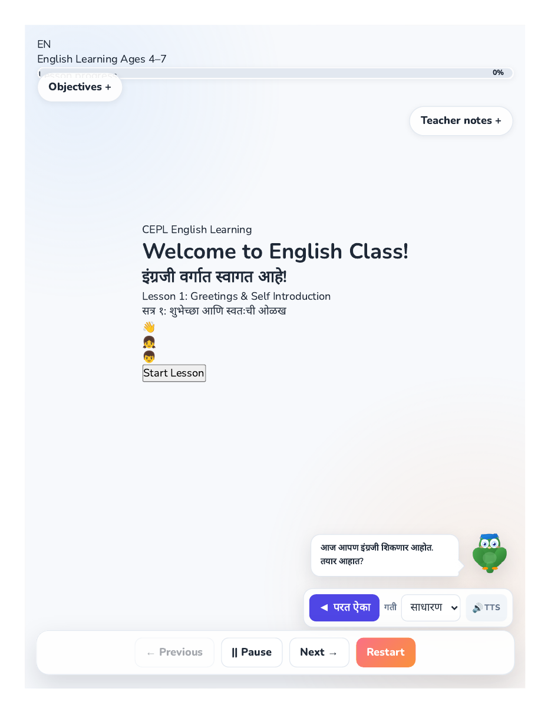
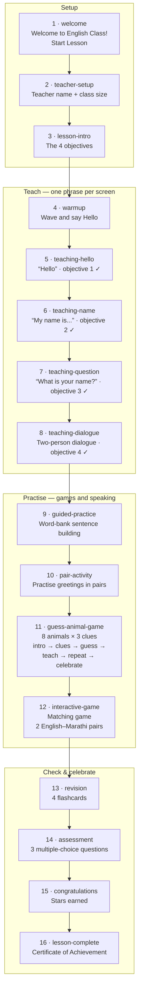
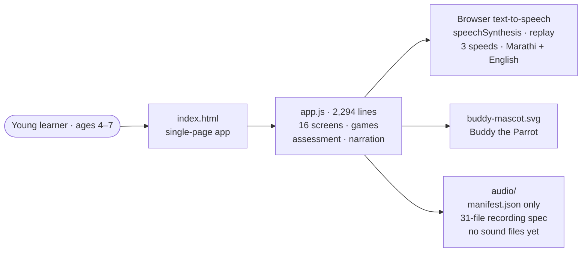

# English Learning App

A simple **English learning app for young learners (ages 4–7)** — first greetings and sentences, taught through a guided lesson with games, spoken narration and a friendly parrot mascot.

**Live:** https://english-learning-app-thiteswapnil1212-hues-projects.vercel.app/

## Screenshots



Welcome screen — 'Welcome to English Class!' with the Marathi heading, Lesson 1: Greetings & Self Introduction, Buddy the Parrot mascot, and narration controls. Screenshot of the live demo, 20 Nov 2026.

## What it is

One guided lesson — **"Say Hello!"** — built for a young child (or a teacher with a small class) learning their first English greetings:

- Say "Hello!"
- Say "My name is..."
- Ask "What is your name?"
- Respond confidently

The lesson runs as **16 screens** (the `screens` array in `app.js`; `totalScreens: 12` at the top of the same file is a stale leftover — navigation and the progress bar both use the real 16), moving from introduction through practice to a short check of what was learned and a certificate. The teacher notes in the code add up to about **60 minutes** for the full lesson.

## Lesson flow



Each teaching screen (5–8) ticks off one of the 4 objectives in the Objectives panel as it is completed.

## What's inside the lesson

- **Teaching screens** — one phrase per screen, each with a listen → meaning → repeat-together → praise pattern and a 3-step pronunciation panel (listen, repeat, say it alone).
- **Guided practice** — build sentences from a word bank (`Hello`, `name`, `is`, `What` …).
- **Pair activity** — children turn to a neighbour and practise greeting each other, then switch roles.
- **Animal guessing game** — guess the animal from 3 clues, in six phases: intro → clues → guess → teach → repeat → celebrate. 8 animals: Cat, Dog, Cow, Goat, Lion, Elephant, Bird, Monkey.
- **Matching game** — match English to Marathi: `Hello` ↔ `नमस्कार`, `My name is` ↔ `माझे नाव आहे`. Each correct match earns a star.
- **Flashcards** — 4 flip-through cards on the revision screen: `Hello` (heh-LOH), `My name is...`, `What is your name?`, and a complete dialogue (`A: Hello! What is your name?` / `B: Hello! My name is Riya.`).
- **Assessment** — 3 multiple-choice questions with immediate feedback (the right answer is highlighted; "Not quite" if wrong) and a Next Question button.
- **Stars** — awarded as the child moves through teaching screens, practice and games; the running total is shown in the header and again on the final certificate.
- **Certificate** — the last screen shows a "Certificate of Achievement" (CEPL English Learning Program) with the lesson name, the date and the total stars earned.
- **Progress bar** — "Lesson progress" from 0% to 100% at the top of every screen (screen number out of 16).
- **Objectives panel** — the 4 lesson objectives, ticked off as each one is completed.
- **Teacher notes panel** — guidance for the current screen, for the adult running the lesson: what the teacher says, what students do, timing, and teaching tips. Every screen has one.

## How it works

- **Spoken narration** — every screen is read aloud with the browser's built-in text-to-speech (`speechSynthesis`, shown as a "TTS" indicator). The app detects Marathi vs English text automatically and picks the matching voice and speed. There are no recorded sound files in the repo: `audio/` contains only a `manifest.json`.
- **Optional pre-recorded audio** — `audio/manifest.json` is a recording spec for 31 Marathi MP3 files (one per screen segment, named `<screenKey>_<segment>.mp3`, plus 9 shared praise/encouragement phrases). If those files are ever placed in `audio/`, the app auto-detects them and prefers the recordings over TTS, falling back to TTS for any missing file (`state.narration.audioMode` switches between `tts` and `files`). No recordings exist yet — the spec also describes the voice wanted (Marathi-speaking female teacher, warm/slow/clear, ~100–120 words per minute, MP3 44100 Hz mono, ≥128 kbps).
- **Replay narration** — a "परत ऐका" (listen again) button replays the current screen's narration.
- **Narration speed** — three speeds, labelled in Marathi: साधारण (normal), हळू (slow), खूप हळू (very slow).
- **Marathi support** — the narration controls and speed labels are in Marathi (Noto Sans Marathi font), so a Marathi-speaking parent or teacher can run the lesson.
- **Buddy the Parrot** — the mascot (`buddy-mascot.svg`) sits on screen with a speech bubble that reacts to the lesson.
- **Navigation** — Previous / Pause / Next / Restart buttons under the lesson area.

## How to use it

Open the live link above, or run it locally — there is no build step and no install:

```bash
# Option 1: open the file directly
open index.html

# Option 2: serve the folder
npx serve .
```

Then press **Next** to walk through the 16 screens. Use **Pause** to stop the narration, **Replay** (परत ऐका) to hear a screen again, and the speed selector to slow the narration down for a younger child.

> Narration needs a browser with speech synthesis (all modern browsers). If a browser has no voices installed, the text is still shown on screen.

## Tech stack

- **Vanilla HTML · CSS · JavaScript** — no framework, no build step, no `package.json`
- **Web Speech API** (`speechSynthesis`) for all narration
- **Google Fonts** — Nunito (English) + Noto Sans Marathi
- **Accessibility** — progress bar, panels and status messages use ARIA roles (`progressbar`, `aria-live`, `aria-label`)

## Architecture



## Project structure

```text
index.html          The app — header, objectives, lesson area, nav, narration controls, mascot
app.js              All lesson logic — 16 screens, games, assessment, narration (2,294 lines)
styles.css          All styling (1,225 lines, 24 sections, responsive down to 420px)
buddy-mascot.svg    Buddy the Parrot
audio/              manifest.json only (no .mp3/.wav files in the repo)
README.md           This file
```

`styles.css` covers the layout, lesson cards, narration controls, mascot, celebration effects and focus states, with responsive breakpoints at 900px, 650px and 420px plus a `prefers-reduced-motion` rule.

## Honest limits

- **No saved progress** — there is no `localStorage` or account; closing the page restarts the lesson from screen 1.
- **One lesson only** — the app teaches greetings ("Say Hello!"). There are no further lessons, levels or letter/number units yet.
- **Narration is synthetic** — it uses the browser's text-to-speech voices, not recorded audio; voice quality depends on the device. The recording spec exists, but no MP3s have been recorded.
- **Certificate name is a placeholder** — the final certificate shows "Amazing Student", not the teacher's or child's name.
- **Stale counter in the code** — `state.totalScreens` is still `12` even though the lesson has 16 screens; nothing in the app reads it (navigation and progress use `screens.length`), so it is harmless but wrong if you read the code.
- **Unused answer slots** — `state.answers` reserves `exercise1–3` and `assessment1–3`, but nothing ever writes to them; the real checks are the practice activities and the 3-question assessment screen.
- **No tests, no build** — the repo has no test suite and no build pipeline.
- **Lesson content renders in JavaScript** — a plain text fetch of the live page shows only the static shell (header, speed control, TTS indicator, mascot); the lesson screens appear once `app.js` runs in a browser.
